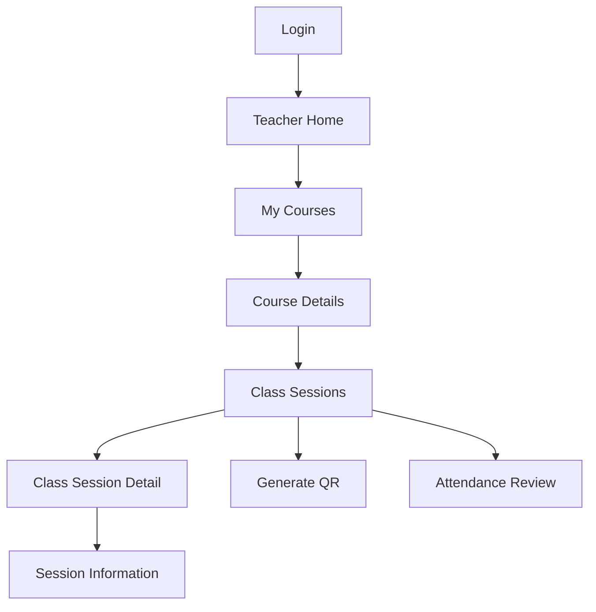

# CP1 — UX Audit: Attendance Control

## 1. Scope

This audit focuses on two teacher screens:

- Class session list
- Class session detail

The analysis is based on the team's original documentation and low-fidelity wireframes.

The main entities are Course, ClassSession, QrCode, and Attendance.

The class session list is associated with the API endpoint `GET /api/classes/course/{courseId}`.

## 2. Current design

The class session management wireframe shows a course title, a list of scheduled sessions, and actions to create a session, open it, generate a QR code, or review attendance.

The navigation documentation defines `/course/:courseId` and `/class-session/:sessionId`.

The class session detail is documented as a route, but its complete visual layout has not yet been defined.

## 3. UX findings

The following findings describe limitations observed in the documentation and areas that require validation during implementation.

| Screen | Finding | UX principle | Severity | Proposed improvement |
|---|---|---|---|---|
| Class list | Loading feedback is not specified. | Visibility of system status | High | Display skeleton rows while sessions load. |
| Class list | An empty-list state is not documented. | Interface states | High | Show a clear message and a Create Class Session action. |
| Class list | API failure feedback is not defined. | Error recovery | High | Display an error message and Retry button. |
| Class list | Multiple actions appear beside each session. | Visual hierarchy | Medium | Prioritize Open and organize secondary actions. |
| Class list | Small-screen behavior is not specified. | Responsive design | Medium | Stack session information and actions on narrow screens. |
| Class list | Touch target sizes are not documented. | Accessibility | Medium | Ensure interactive controls are at least 44 px high. |
| Class detail | A complete visual layout is missing. | Consistency | High | Design a structured detail screen for ClassSession fields. |
| Class detail | Loading and error recovery are not documented. | Feedback and recovery | High | Add loading, error, and retry states. |

These findings are based on design coverage, not measured usability defects in a running mobile application.

## 4. Current navigation

### Navigation observations

- Course management begins from the teacher's home screen.
- A teacher selects a course before accessing its class sessions.
- The session list provides access to session-related actions.
- The detail screen needs a clear back-navigation path.
- The route structure is documented, but the complete teacher interaction flow still requires implementation and validation.

## 5. Evidence and references

The audit uses these documents from the Attendance Control repository:

- `02-code-and-ui/wireframes/README.md`
- `01-architecture/navigation.md`
- `03-api-and-data/entities/class-session.md`

The teacher screens are low-fidelity wireframes. They must not be presented as screenshots of a completed mobile application.

### Original class session list wireframe

### Class session detail — Design status

The class session detail is defined in the navigation
documentation through `/class-session/:sessionId`.

However, the supplied documentation does not include
a complete visual wireframe for this screen.

The UX audit identifies this as a design gap.
The detail screen will be implemented using the
ClassSession entity and the team's navigation guidelines.

Source: Attendance Control team documentation,
`02-code-and-ui/wireframes/README.md`.

This image represents the original low-fidelity wireframe,
not a screenshot of a running mobile application.

## 6. Priorities

The first implementation priority is the class session list because it is the main entry point to class information.

Loading, empty, and error states should be implemented before adding secondary visual improvements.

The second priority is the class session detail, including consistent navigation and clear information hierarchy.
