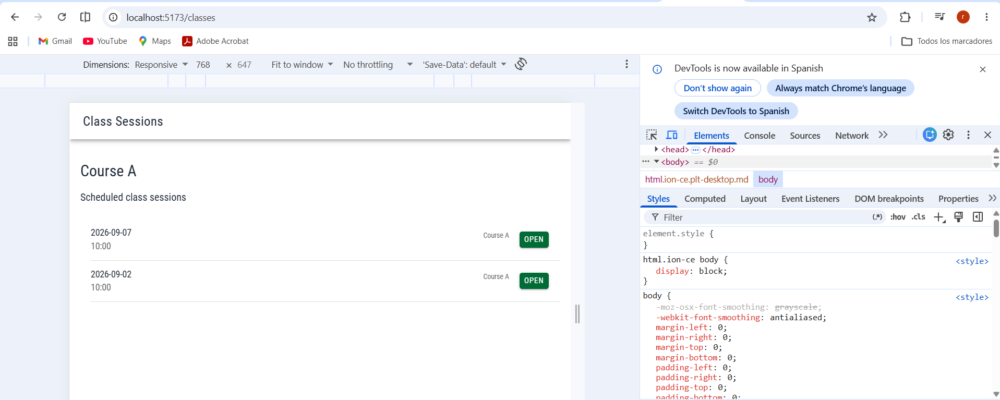
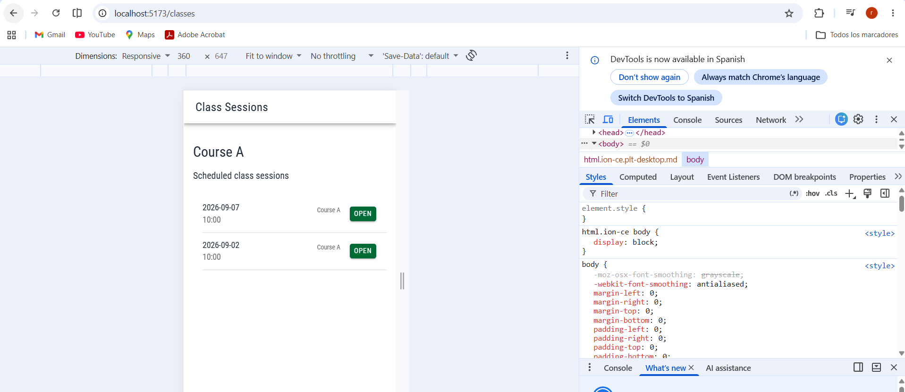

# CP4 — Accessibility and Responsive Design

## 1. Objective

Review accessibility and responsive behavior in the Attendance Control class session interface.

## 2. Responsive verification

The Class Sessions screen was visually reviewed at two viewport widths:

- 360 px: mobile layout.
- 768 px: tablet layout.

At both widths, class session dates, times, and Open buttons remained visible. No apparent text overlap or horizontal overflow was observed.

## 3. Evidence

### Class Sessions — 360 px

### Class Sessions — 768 px

## 4. Accessibility improvements

The interface includes:

- Descriptive page headings.
- Accessible labels for class session navigation buttons.
- A readable error message with an alert role.
- A Retry button for loading failures.
- Skeleton placeholders during loading.
- A darker primary green token for improved contrast against white text.

## 5. Verification status

- Responsive list at 360 px: visually reviewed.
- Responsive list at 768 px: visually reviewed.
- Class detail responsive screenshots: not collected.
- Keyboard navigation: pending verification.
- Lighthouse accessibility audit: pending.

## 6. Limitations

The current screens use simulated data based on the team's original project documentation.

The responsive observations are based on manual visual inspection. They do not establish full WCAG compliance.
