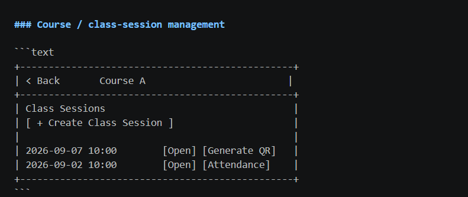
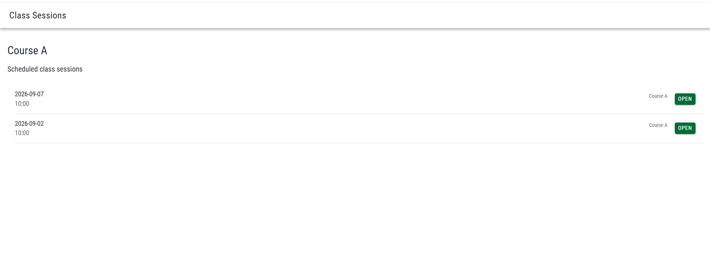
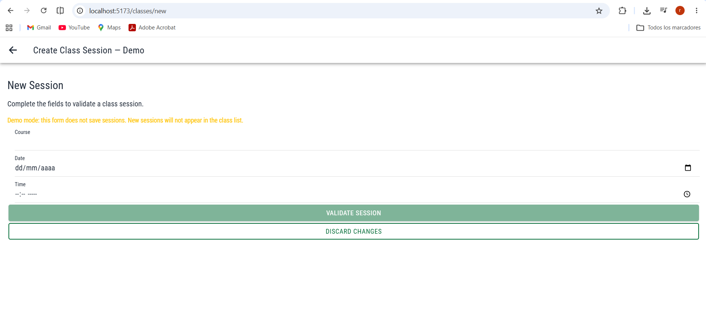

# CP9 — Before and After: Attendance Control UX/UI

## 1. Objective

Document the improvements made to the class session list, detail screen, and session form, and propose user stories for the team's implementation backlog.

## 2. Before and After — Class Sessions List

### Before

The initial class management interface was based on the team's wireframe. It provided the basic structure for viewing course sessions, but did not demonstrate loading, empty, or error feedback.

### After

The implemented list provides session dates, times, an Open action, a Create Session button, loading skeletons, empty-state feedback, error handling, Retry, and pull-to-refresh.

**UX principle:** Visibility of system status, clear navigation, and error recovery.

## 3. Before and After — Class Session Detail

### Before

The original navigation documentation described the class-session workflow. The initial detail implementation displayed session data but did not handle asynchronous loading or simulated service errors.

### After

The detail screen receives the session identifier from `/class-session/:sessionId` and handles loading, available data, errors, and missing sessions.

**UX principle:** Consistent navigation and informative feedback.

## 4. Before and After — Session Form

### Before

The initial form implementation could validate information but did not persist new sessions. During usability testing, participants expected the newly submitted session to appear in the class list.

### After

The form now includes a visible demo-mode warning, field validation, error feedback, loading feedback, a discard confirmation, and a success message stating that no session was saved.

**UX principle:** Accurate feedback and consistency between system behavior and user expectations.

## 5. User Stories for the Team Backlog

### Story 1 — Reliable Session Creation

As a professor, I want a newly created class session to be saved and displayed in my class list, so I can manage attendance sessions reliably.

**Acceptance criteria:**
- Valid session data is submitted to the real backend.
- After a successful response, the new session appears in the list.
- API failures produce a clear error without displaying a false success message.

### Story 2 — Clear Class Session States

As a professor, I want clear loading, empty, and error states when viewing my sessions, so I know whether the application is working or requires an action.

**Acceptance criteria:**
- Loading displays skeleton placeholders.
- An empty response displays an informative message.
- Service failures display an error and Retry.
- Retry requests the session data again.

### Story 3 — Accessible Class Details

As a professor, I want to open a session and return to my class list easily, so I can review session information without getting lost.

**Acceptance criteria:**
- Selecting Open navigates to the matching session identifier.
- The detail displays the correct course, date, and time.
- An unknown identifier displays a not-found message.
- Back navigation returns to the class list.

## 6. Limitations

The current workshop implementation uses simulated data. Real persistence must be implemented and tested in the team's backend and frontend repositories.

The original detail and form screens do not have separate before screenshots available in the current evidence set.
