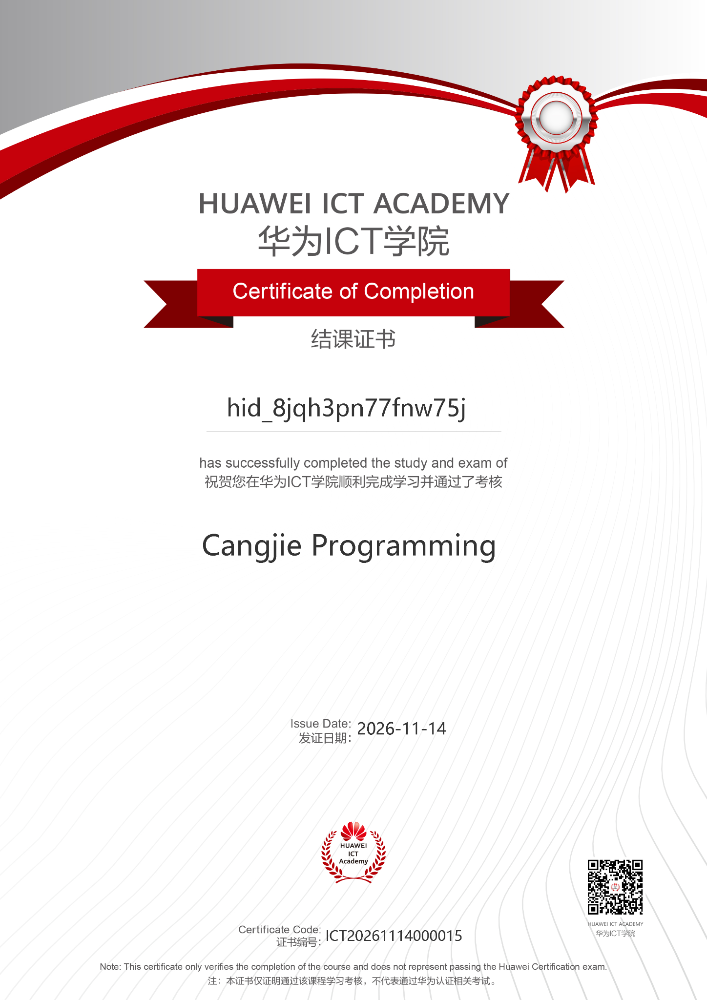
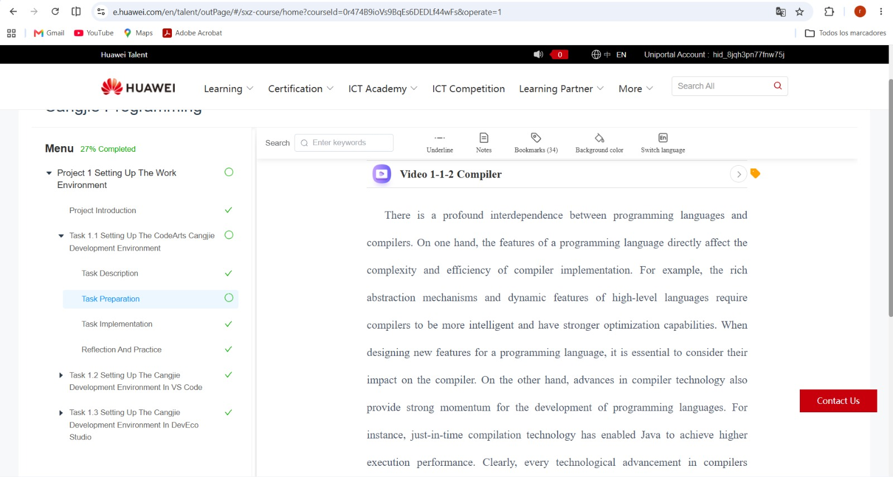
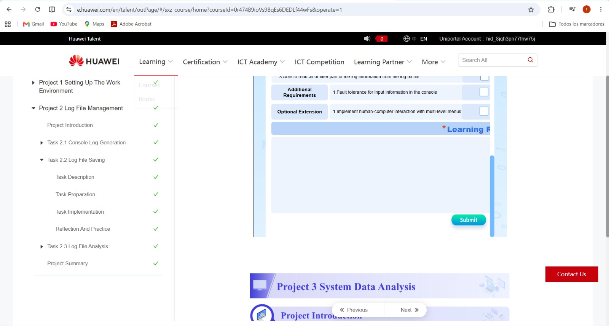
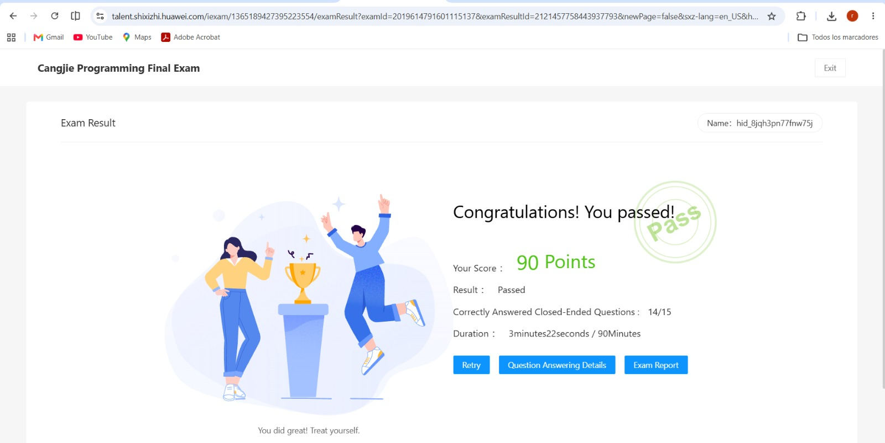
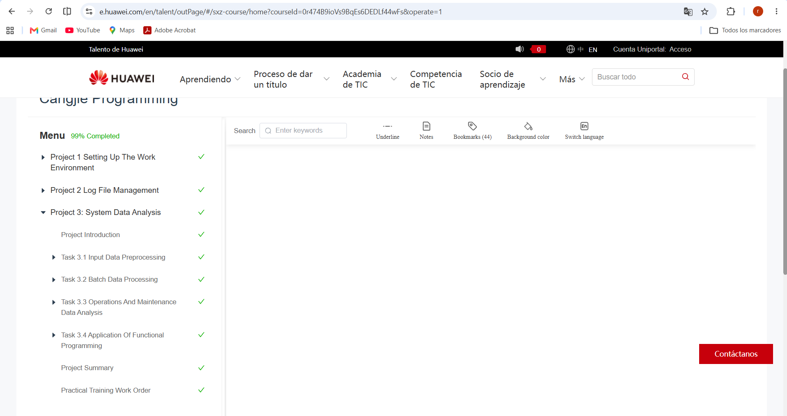

# Certificación Corte 3 - Programación Móvil

## Datos del estudiante

- Nombre: Rosfeller David Castillo Garzón
- Curso: Programación Móvil
- Certificación: Cangjie Programming
- Institución: Huawei ICT Academy
- Duración del curso: 56 horas
- Fecha de inicio: 11 de noviembre de 2026
- Fecha de emisión del certificado: 14 de noviembre de 2026

## Descripción

Como parte de la certificación del tercer corte de Programación Móvil, se realizó el curso Cangjie Programming de Huawei ICT Academy.

El curso comprende tres proyectos principales:

1. Setting Up the Work Environment.
2. Log File Management.
3. System Data Analysis.

## Resultado del examen final

- Calificación: 90 puntos.
- Resultado: Aprobado.
- Preguntas cerradas correctas: 14 de 15.

## Evidencias

En esta carpeta se almacenarán las capturas de pantalla del desarrollo del curso y el certificado oficial de finalización.

## Certificado oficial

El certificado de finalización fue emitido por Huawei ICT Academy el 14 de noviembre de 2026.

### Evidencia del certificado oficial

Se obtuvo el certificado de finalización del curso Cangjie Programming de Huawei ICT Academy.

## Evidencias del desarrollo del curso

### Proyecto 1. Configuración del entorno de desarrollo

Evidencia del curso Cangjie Programming relacionada con la preparación del entorno de trabajo.

### Proyecto 2. Gestión de archivos de registro

Evidencia del módulo Log File Management, que aborda la generación, almacenamiento y análisis de registros.

### Examen final

Se aprobó el examen final de Cangjie Programming con una calificación de 90 puntos y 14 de 15 preguntas cerradas correctas.

### Progreso del curso

La siguiente captura muestra un avance del 99 % y los tres proyectos marcados como completados.

